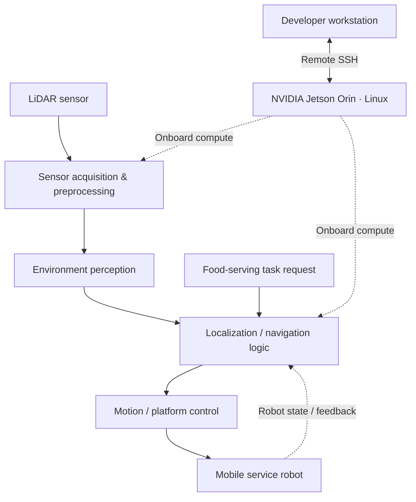

<div align="center">

# ORBIT
### LiDAR-Based Autonomous Food-Serving Robot

**An edge-computing robotics project exploring reliable indoor navigation and service automation.**

[](https://developer.nvidia.com/embedded/jetson-modules)


[Overview](#overview) · [System Concept](#system-concept) · [Engineering Focus](#engineering-focus) · [Development](#development-and-deployment) · [Evaluation](#evaluation-framework) · [Roadmap](#roadmap)

</div>

---

## Overview

**ORBIT** is a LiDAR-based autonomous food-serving robot project centered on **mobile robotics, onboard perception, and edge-device deployment**. The project explores how a mobile service platform can sense its indoor surroundings, support navigation decisions, and assist with food delivery in environments such as cafeterias, dining areas, and institutional spaces.

Its development environment uses an **NVIDIA Jetson Orin**, **Linux**, and **remote SSH** for working with the onboard computer. **LiDAR** is the core sensing modality described for the robot.

> **Repository status:** Project documentation is being established; the local source code, hardware-specific configuration, and demonstration assets have **not yet been imported** into this repository. Sections labeled *design goal* or *planned* describe intended work, not verified implemented features.

## Problem & Motivation

Repetitive point-to-point delivery in indoor facilities is a useful setting for autonomous service robotics. A practical food-serving robot must balance environmental awareness, smooth movement, operational reliability, and appropriate human supervision.

ORBIT's research direction is to connect **LiDAR-based scene understanding** with a compact **onboard computing platform**, while keeping the system observable and maintainable through remote development workflows.

### Engineering goals

- **Environmental perception:** collect and interpret LiDAR measurements for indoor spatial awareness.
- **Navigation autonomy:** investigate localization, route execution, and obstacle-aware movement as part of the robotics workflow.
- **Edge execution:** develop and operate robotics software on NVIDIA Jetson Orin hardware.
- **Service-task integration:** connect perception and movement with structured food-serving tasks.
- **Operational reliability:** make robot behavior inspectable, testable, and safe for supervised indoor experimentation.

## System Concept

The following diagram presents the **intended logical architecture**. It is a design overview, not a claim that every block is already implemented.



**Primary processing path:** LiDAR data → scene representation → navigation decision → platform action → feedback.

For a real-world system, the specific sensor driver, localization method, control interface, and failure-handling behavior must be documented and validated against the implementation.

## Hardware & Software

| Component | Role | Verification |
|:--|:--|:--|
| **NVIDIA Jetson Orin** | Onboard edge-computing platform | Project-provided hardware |
| **LiDAR** | Range sensing and environmental perception | Project-provided sensing modality |
| **Linux** | Onboard development/runtime environment | Project-provided environment |
| **SSH** | Remote access, development, and diagnostics | Project-provided workflow |
| Robot base, motor controller, battery | Physical mobility and power | Exact models to document |
| Sensor libraries and navigation software | Data acquisition and autonomy | To verify from source code |

### Engineering focus

**1. LiDAR perception**  
Sensor acquisition, range-data handling, spatial interpretation, and understanding measurement limitations in indoor spaces.

**2. Autonomous navigation**  
Exploring robust navigation behavior in the presence of static obstacles, moving people, and constrained service routes.

**3. Embedded AI / edge robotics**  
Working within the compute, resource, and deployment constraints of a Jetson-based mobile system.

**4. Remote engineering workflow**  
Using Linux and SSH for remote inspection, configuration, debugging, and iterative testing.

## Development and Deployment

> Full dependency versions, launch commands, wiring diagrams, and hardware setup instructions will be added **after the local project source is reviewed and imported**. This avoids publishing commands that may not match the actual implementation.

### Get the repository

```bash
git clone https://github.com/Kanishkar843/ORBIT.git
cd ORBIT
```

### Connect to the robot's onboard computer

From an authorized development workstation on the robot's permitted network:

```bash
ssh <username>@<jetson-ip-address>
```

Replace the placeholders with the configured device username and address. SSH access should use the device owner's authorized credentials; do not commit keys or passwords.

### Reproducible setup checklist

- [ ] Document Jetson Orin model, OS release, and installed runtime.
- [ ] Record LiDAR manufacturer/model, interface, and driver.
- [ ] Document robot chassis, motor controller, and power system.
- [ ] Add dependency manifests and exact installation steps.
- [ ] Add verified launch and shutdown procedures.
- [ ] Add system diagrams, photographs, and a supervised demo.
- [ ] Define a supervised testing and emergency-stop procedure.

## Evaluation Framework

The following **proposed measurements** can make the project reproducible and research-oriented. No numerical performance results are claimed yet.

| Dimension | Suggested measurement |
|:--|:--|
| Perception | Valid LiDAR readings, update rate, dropped measurements |
| Navigation | Goal-reaching rate across repeatable indoor routes |
| Obstacle handling | Correct detection and safe stopping under supervised tests |
| Runtime | CPU/GPU usage, memory footprint, sensing-to-action latency |
| Task execution | Successful food-delivery task completions and recovery cases |
| Reliability | Run duration, faults, and documented failure modes |

**Test methodology:** define a fixed indoor test area, document the robot and sensor configuration, repeat the same scenario under controlled conditions, and report both successful runs and failures. Conduct testing under appropriate human supervision.

## Roadmap

- [ ] **Source-code import** — publish the verified project files with appropriate exclusions.
- [ ] **Hardware documentation** — add a bill of materials, wiring overview, and device versions.
- [ ] **Perception documentation** — explain the actual LiDAR driver and processing pipeline.
- [ ] **Navigation documentation** — describe the implemented algorithms and control interfaces.
- [ ] **Demo & results** — add real system media and repeatable experimental findings.
- [ ] **Research extension** — investigate camera/LiDAR fusion or higher-level language-guided service tasks where technically feasible.

## Research Relevance

ORBIT provides a project context for research in:

- **LiDAR and 3D perception** for autonomous systems.
- **Robotic navigation and service automation** in shared indoor spaces.
- **Edge AI deployment** on constrained robotics hardware.
- **Multimodal sensing and intelligent task planning** as future research extensions.

These directions align naturally with research involving LiDAR–camera fusion, computer vision, and AI-assisted robot control, while keeping a clear distinction between **current project evidence** and **future research possibilities**.

## Documentation & Media

As the verified project files become available, this repository will include configuration details, a setup guide, architecture diagrams, and demonstrations recorded from the actual robot. Please avoid interpreting conceptual diagrams as evidence of a completed autonomous deployment.

## Maintainer

**Kanishkar B** · [GitHub](https://github.com/Kanishkar843)

---

<div align="center">
  <sub><strong>ORBIT</strong> · Perception-driven service robotics · Engineering through measurable, reproducible experiments.</sub>
</div>
