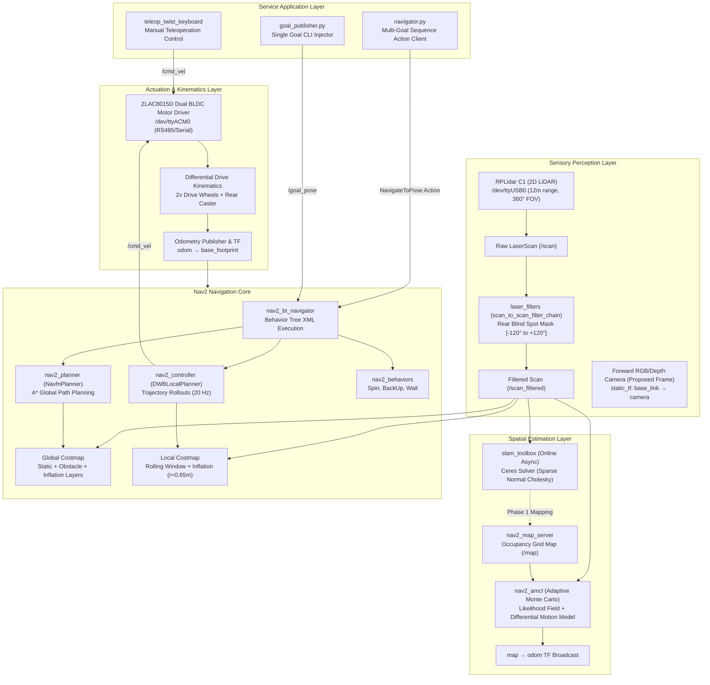
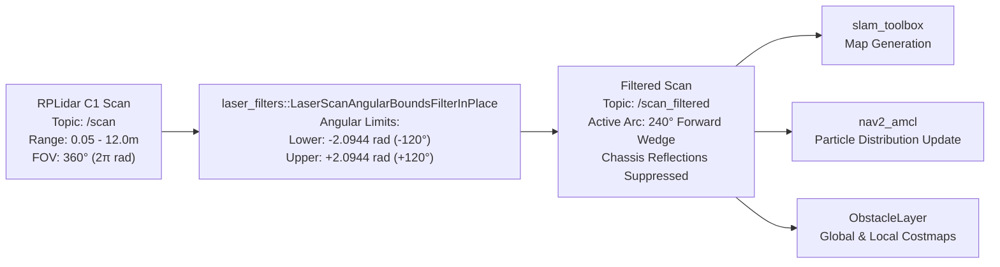
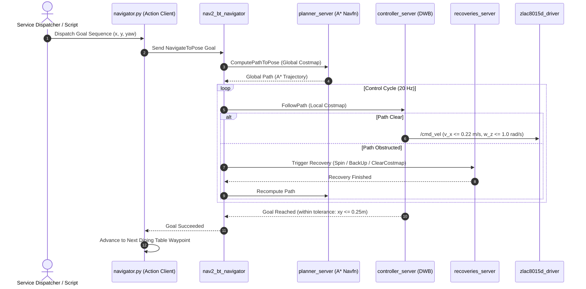
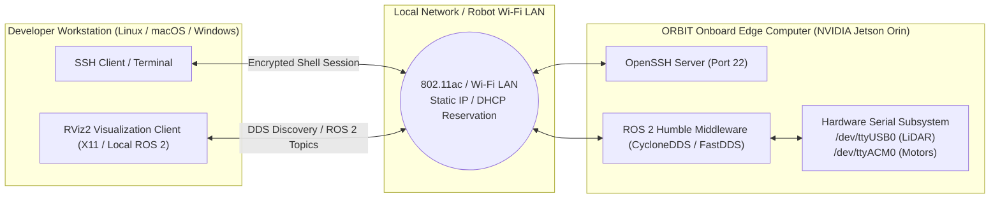

# ORBIT System Architecture

This document provides a detailed breakdown of the hardware interfaces, coordinate transformation trees, sensor processing pipelines, Nav2 navigation stack integration, and software lifecycle execution for the **ORBIT (LiDAR-Based Autonomous Food-Serving Robot)** platform.

---

## 1. High-Level System Architecture

The ORBIT platform executes an autonomous service workflow designed for indoor dining and food delivery. The robot integrates real hardware sensing, SLAM, probabilistic localization, global path planning, local obstacle avoidance, and dual-channel brushless DC motor control on an onboard NVIDIA Jetson Orin edge computer.



---

## 2. Coordinate Transformation (TF) Tree

All coordinate transformations adhere strictly to the **ROS REP-103** (Standard Units of Measure & Coordinate Conventions) and **REP-105** (Coordinate Frames for Mobile Platforms) standards.

```mermaid
graph TD
    map["map (Global Fixed World Frame)"] -->|AMCL / SLAM Toolbox| odom["odom (Odometry World Frame)"]
    odom -->|zlac8015d_driver| base_footprint["base_footprint (2D Ground Projection)"]
    base_footprint -->|diffbot.urdf / static_tf (z=0.10m)| base_link["base_link (Chassis Origin)"]
    
    base_link -->|diffbot.urdf (x=0.0, y=0.15, z=0.0)| left_wheel["left_wheel (Drive Wheel)"]
    base_link -->|diffbot.urdf (x=0.0, y=-0.15, z=0.0)| right_wheel["right_wheel (Drive Wheel)"]
    base_link -->|diffbot.urdf / static_tf (x=-0.15, y=0.0, z=-0.05)| caster_wheel["caster_wheel (Support Caster)"]
    base_link -->|diffbot.urdf / static_tf (x=0.0, y=0.0, z=0.18)| lidar["lidar (RPLidar C1 Optical Center)"]
    base_link -.->|static_tf (x=0.10, y=0.0, z=0.15) [Configured]| camera["camera (Forward Optical Frame)"]

    classDef frame fill:#1e293b,stroke:#3b82f6,stroke-width:2px,color:#f8fafc;
    classDef planned fill:#0f172a,stroke:#eab308,stroke-width:2px,stroke-dasharray: 5 5,color:#fbbf24;
    class map,odom,base_footprint,base_link,left_wheel,right_wheel,caster_wheel,lidar frame;
    class camera planned;
```

### Frame Responsibilities and Spatial Offsets

| Frame ID | Parent Frame | Broadcast Authority | Transform (x, y, z, roll, pitch, yaw) | Purpose |
| :--- | :--- | :--- | :--- | :--- |
| `map` | *Global Origin* | `nav2_amcl` or `slam_toolbox` | Dynamic (based on scan-to-map registration) | Fixed inertial reference frame accounting for odometric drift. |
| `odom` | `map` | `zlac8015d_driver` (hardware bringup) | Dynamic (integrated wheel encoder odometry) | Continuous smooth local reference frame; accumulates drift over time. |
| `base_footprint` | `odom` | `zlac8015d_driver` | `(0, 0, 0, 0, 0, 0)` | 2D planar projection of the robot footprint on the ground plane. |
| `base_link` | `base_footprint` | `diffbot.urdf` (`robot_state_publisher`) / fallback static TF | `(0.00, 0.00, 0.10 m, 0, 0, 0)` | Geometric structural centroid of the physical robot chassis. |
| `lidar` | `base_link` | `diffbot.urdf` / fallback static TF | `(0.00, 0.00, 0.18 m, 0, 0, 0)` | Optical measurement center of the RPLidar C1 range scanner. |
| `left_wheel` | `base_link` | `diffbot.urdf` | `(0.00, +0.15, 0.00 m, -π/2, 0, 0)` | Left differential drive traction hub. |
| `right_wheel` | `base_link` | `diffbot.urdf` | `(0.00, -0.15, 0.00 m, -π/2, 0, 0)` | Right differential drive traction hub. |
| `caster_wheel` | `base_link` | `diffbot.urdf` / fallback static TF | `(-0.15, 0.00, -0.05 m, 0, 0, 0)` | Rear passive caster for tri-point planar stability. |
| `camera` *(Configured)* | `base_link` | Static transform publisher (`mapping_real.launch.py`) | `(0.10, 0.00, 0.15 m, 0, 0, 0)` | Forward-facing optical sensor frame for computer vision / fusion. |

> **TF Conflict Prevention:** The ROS 2 launch architecture guarantees that `robot_state_publisher` is owned solely by `hardware_bringup.launch.py`. Redundant state publishers in mapping or navigation launches are omitted to eliminate duplicate TF publication and time-synchronization jitter ("extrapolation into future" errors).

---

## 3. Sensor Acquisition and Filtering Pipeline

The physical robot chassis introduces self-occlusion in the rear 120° wedge. The RPLidar C1 360° scan is filtered using an angular bounds filter prior to passing data to SLAM or Nav2 costmaps.



### Filtering Configuration Rationale

1. **Self-Obstruction Elimination:** Without angular bounds filtering, raw laser pulses reflect off the food-serving trays and chassis structure, causing the robot to falsely detect immediate obstacles at $r < 0.22\text{ m}$.
2. **Deterministic Computational Savings:** Discarding invalid rear range points reduces the raytracing overhead in Nav2 costmap 2D clearing/marking cycles.

---

## 4. Software Lifecycle & Staggered Initialization Architecture

On embedded edge hardware such as the NVIDIA Jetson Orin, launching all SLAM and Nav2 lifecycle nodes concurrently creates severe CPU and memory bus contention, leading to lifecycle bond timeouts. ORBIT employs a **staggered timer-action startup sequence**:

```mermaid
gantt
    title ORBIT Node Startup Sequence (navigation_real.launch.py)
    dateFormat X
    axisFormat %s s
    section Bringup
    laser_filters (/scan -> /scan_filtered) :0, 1
    map_server & amcl                       :5, 6
    section Localization Lifecycle
    lifecycle_manager_localization autostart :5, 6
    section Planning & Control
    planner_server (A* Global Planner)      :5, 6
    controller_server (DWB Local Planner)   :6, 7
    rviz2 (Remote Visualizer)               :6, 7
    section Behavior Engine
    recoveries_server (Spin/Backup/Wait)    :7, 8
    bt_navigator (Behavior Tree Engine)     :8, 9
    section Navigation Lifecycle
    lifecycle_manager_navigation autostart  :10, 11
```



---

## 5. Navigation & Decision-Making Pipeline

ORBIT uses Nav2's action-oriented client-server model for food-serving navigation:



---

## 6. Edge Computing & Remote Development Topology



### Communication Interfaces

- **Remote SSH Administration:** Headless operation allows developers to start, monitor, and shut down ROS 2 nodes over an authenticated network shell.
- **DDS Middleware:** Native ROS 2 discovery protocols enable telemetry, `/scan_filtered`, `/map`, `/tf`, and costmap streaming directly to workstation RViz instances.
- **Hardware Bus Isolation:** LiDAR and motor controller are attached to discrete serial USB controllers, preventing packet starvation during simultaneous high-rate scan streaming and encoder polling.
