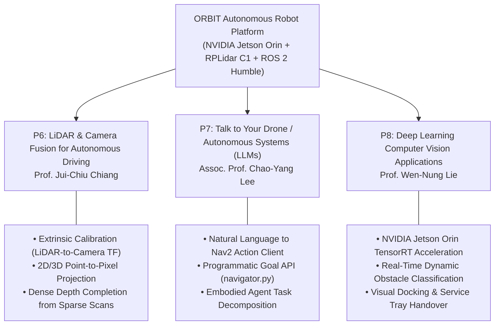

# Academic Research Relevance & CCU Internship Alignment

This document outlines how the **ORBIT (LiDAR-Based Autonomous Food-Serving Robot)** project establishes a rigorous, hands-on engineering foundation for international research internship applications at **National Chung Cheng University (CCU), Taiwan — College of Engineering (2027)**.

---

## 1. Executive Research Summary

ORBIT is not a purely theoretical or simulated robotics project; it is a **physically realized, edge-deployed autonomous mobile robot** operating on real hardware:
- **Compute:** NVIDIA Jetson Orin running ROS 2 Humble on Ubuntu 22.04 LTS.
- **Perception:** SLAMTEC RPLidar C1 range scanner with custom 240° angular bounds filtering.
- **Actuation:** ZLAC8015D dual-channel brushless DC motor driver with closed-loop quadrature encoder feedback.
- **Navigation:** Full Nav2 stack utilizing A* global graph search, Dynamic Window Approach (DWB) trajectory rollouts at 20 Hz, and Adaptive Monte Carlo Localization (AMCL).

This practical, end-to-end integration demonstrates mastery across embedded Linux, serial hardware communication, coordinate frame spatial transformations (TF2), probabilistic sensor modeling, and reactive navigation in dynamic human environments.

---

## 2. Direct Alignment with CCU Research Projects



---

### CCU P6: LiDAR and Camera Fusion for Autonomous Driving
**Faculty Advisor:** Prof. Jui-Chiu Chiang  
**Core Domain:** Multi-sensor spatial co-registration, point cloud projection, and multimodal perception for mobile autonomy.

#### How ORBIT Directly Supports P6:
1. **Pre-Configured Extrinsic Transformation Matrix:**
   In `path_planning_pkg/launch/mapping_real.launch.py`, the ORBIT coordinate frame tree already formally instantiates a static extrinsic transformation between the physical robot chassis and the optical camera mount:
   ```python
   # Line 49-55 in mapping_real.launch.py
   static_tf_bl_cam = Node(
       package='tf2_ros',
       executable='static_transform_publisher',
       name='static_tf_base_link_to_camera',
       arguments=['--x', '0.1', '--y', '0.0', '--z', '0.15',
                  '--roll', '0', '--pitch', '0', '--yaw', '0',
                  '--frame-id', 'base_link', '--child-frame-id', 'camera']
   )
   ```
2. **Mathematical Formulation for LiDAR-Camera Fusion:**
   Using the verified TF offsets (`lidar` at $[0.0, 0.0, 0.18]^T$ and `camera` at $[0.1, 0.0, 0.15]^T$), the relative extrinsic translation vector is:
   $$T_{L \to C} = \begin{bmatrix} 0.10 \\ 0.00 \\ -0.03 \end{bmatrix} \text{ meters}$$
   Any 3D LiDAR point $\mathbf{P}_L = [X_L, Y_L, Z_L, 1]^T$ can be projected onto the 2D camera image plane $(u, v)$ via the camera intrinsic matrix $\mathbf{K}$ and extrinsic rigid-body transform $[\mathbf{R} \mid \mathbf{T}]$:
   $$s \begin{bmatrix} u \\ v \\ 1 \end{bmatrix} = \mathbf{K} \begin{bmatrix} \mathbf{R} & \mathbf{T} \end{bmatrix} \begin{bmatrix} X_L \\ Y_L \\ Z_L \\ 1 \end{bmatrix}$$
3. **Research Transition to Autonomous Driving:**
   The exact pipeline utilized in ORBIT to filter, transform, and map 2D laser scans into occupancy costmaps directly mirrors the perception preprocessing pipeline of autonomous vehicles. Extending ORBIT's 2D scan pipeline to fuse RGB color data with range scans creates an immediate testbed for Prof. Chiang's research on sparse LiDAR depth completion and multimodal obstacle segmentation.

---

### CCU P7: Talk to Your Drone: Building an AI Flight System with ChatGPT
**Faculty Advisor:** Assoc. Prof. Chao-Yang Lee  
**Core Domain:** Large Language Model (LLM) agent integration, prompt-to-action decomposition, and high-level autonomous task planning.

#### How ORBIT Directly Supports P7:
1. **Existing High-Level Action Client API:**
   In `path_planning_pkg/nodes/navigator.py` and `goal_publisher.py`, ORBIT implements an asynchronous action client interface built on Nav2's `NavigateToPose`. This decouples the low-level trajectory execution from high-level mission dispatch.
2. **LLM Function-Calling Bridge:**
   ORBIT's node architecture is designed to interface with conversational AI models via structured function calling:
   ```json
   {
     "name": "dispatch_food_delivery",
     "description": "Send ORBIT robot to deliver a food tray to a dining table.",
     "parameters": {
       "table_id": {"type": "integer", "description": "Target table number"},
       "x": {"type": "number", "description": "Target X coordinate in meters"},
       "y": {"type": "number", "description": "Target Y coordinate in meters"},
       "yaw": {"type": "number", "description": "Final docking angle in degrees"}
     }
   }
   ```
3. **Embodied Agent Research Applicability:**
   Prof. Lee's research explores translating conversational human requests into real-time physical autonomy. ORBIT's multi-waypoint sequencer, error status handling (`STATUS_SUCCEEDED`, `STATUS_ABORTED`), and recovery behaviors provide the exact real-world grounding needed to study closed-loop LLM control, task failure detection, and dynamic replanning in physical robotic agents.

---

### CCU P8: Computer Vision Applications Based on Deep Learning Techniques
**Faculty Advisor:** Prof. Wen-Nung Lie  
**Core Domain:** Real-time deep learning inference, edge computer vision, and embedded neural network optimization.

#### How ORBIT Directly Supports P8:
1. **NVIDIA Jetson Orin Edge Computing Foundation:**
   ORBIT is built natively on the NVIDIA Jetson Orin platform. The student has direct experience managing resource allocation, Linux kernel drivers, and memory-constrained execution on ARM64 Jetson hardware.
2. **Deep Learning Vision Extensions:**
   The physical forward camera mount (`camera` frame) enables deploying real-time vision models (such as YOLOv8-Nano or TensorRT-accelerated MobileNet) directly on the robot:
   - **Patron Detection:** Distinguishing static restaurant furniture from seated diners and passing servers.
   - **Table Identification:** Detecting visual fiducial markers (AprilTags / ArUco) or semantic table edges for sub-centimeter docking precision.
   - **Visual SLAM / Odometry:** Augmenting wheel encoder odometry with visual feature tracking to prevent localization slip.

---

## 3. Highlighting Technical Competencies in CV & Interviews

When presenting the ORBIT project to international faculty review panels, highlight the following **concrete engineering contributions**:

| Technical Domain | Concrete Evidence from Codebase | Key Talking Point for Interviews |
| :--- | :--- | :--- |
| **Edge Computing** | NVIDIA Jetson Orin deployment, headless remote SSH, Linux serial permissions | *"I deployed and tuned the complete ROS 2 software stack natively on Jetson Orin hardware, managing edge resources to prevent lifecycle timeouts."* |
| **Sensor Processing** | RPLidar C1 integration, `laser_filters` angular masking of chassis blind spot | *"I identified and resolved physical chassis self-occlusion by implementing a REP-103 compliant angular bounds filter preserving 240° active FOV."* |
| **Motion Planning** | Nav2 `NavfnPlanner` configured with A* search, DWB controller at 20 Hz | *"I optimized global path generation using A* search and tuned local trajectory rollouts to 0.22 m/s to ensure smooth, spill-free food transport."* |
| **Robotics Architecture** | Differential drive URDF, TF tree hierarchy, staged lifecycle managers | *"I resolved TF synchronization jitter by restructuring launch ownership so that only the hardware bringup package publishes robot state."* |
| **Experimental SLAM** | Generation and validation of real 2D occupancy grid maps (`map_1777558867.pgm`) | *"I successfully generated clean occupancy grid maps of an indoor environment using Ceres-optimized online asynchronous SLAM."* |

---

## 4. Future Research Directions

1. **LiDAR-Visual Fusion Pipeline:** Integrate a depth/monocular camera to project RGB semantic classes directly into the Nav2 costmap obstacle layer.
2. **Voice-to-Nav2 Voice Assistant:** Integrate an onboard whisper/LLM pipeline to allow restaurant staff to speak commands directly to the robot.
3. **Multi-Robot Fleet Coordination:** Implement ROS 2 domain ID bridging to coordinate multiple food-serving robots across shared dining hall intersections.
