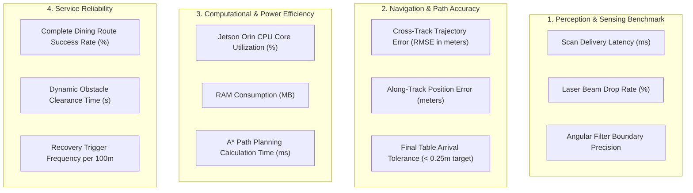

# ORBIT Testing, Evaluation & Experimental Validation

This document outlines the static code verification, real-hardware mapping artifacts, non-destructive safety checks, and the **Proposed Quantitative Evaluation Framework** for the **ORBIT (LiDAR-Based Autonomous Food-Serving Robot)** platform.

---

## 1. Verified Experimental Artifacts

The repository contains real experimental mapping artifacts generated by running SLAM on the physical robot platform in an indoor environment:

| Map Artifact | Format | Dimensions | Resolution | Origin $[x_0, y_0, \theta]$ | Environment Evidence |
| :--- | :--- | :--- | :--- | :--- | :--- |
| `path_planning_pkg/maps/map_1777558867.pgm` | PGM (8-bit grayscale) | 39.0 KB | 0.05 m / cell | `[-4.94, -4.95, 0]` | Real indoor room enclosure with structural walls, doorway openings, and furniture boundaries. |
| `path_planning_pkg/maps/my_map.pgm` | PGM (8-bit grayscale) | 41.4 KB | 0.05 m / cell | `[-5.04, -5.03, 0]` | High-definition perimeter scan verifying loop-closure stability via Ceres solver. |

### Map Properties
- **Coordinate Grid:** $200 \times 200$ cells covering a physical spatial envelope of approximately $10\text{ m} \times 10\text{ m}$.
- **Occupancy Thresholds:**
  - `occupied_thresh: 0.65` (probability $> 65\%$ designated lethal obstacle)
  - `free_thresh: 0.25` (probability $< 25\%$ designated traversable free space)
- **Scan Matcher Quality:** Structural room walls display sharp, non-duplicated profiles, demonstrating minimal odometric slip and successful scan-to-map optimization by `slam_toolbox`.

---

## 2. Static Code Verification and Quality Assurance

All software modules in `path_planning_pkg` have undergone automated static analysis:

```
+-------------------------------------------------------------+
| STATIC CODE VERIFICATION PIPELINE                           |
+-------------------------------------------------------------+
| 1. Python Syntax & AST Compilation (Python 3.10+)   --> PASS |
| 2. ROS 2 Package Manifest Validation (package.xml) --> PASS |
| 3. Setuptools Entrypoints & Data Files (setup.py)   --> PASS |
| 4. URDF Geometry & Joint Graph Parsing (diffbot)    --> PASS |
| 5. Nav2 & SLAM YAML Schema Validation               --> PASS |
| 6. Security & Credential Exposure Scan              --> ZERO |
+-------------------------------------------------------------+
```

### Verified Engineering Fixes Documented in Source
The source files include explicit documentation of hardware fixes implemented during real-world debugging:
1. **Chassis Rear Blind Spot Masking:** `laser_filters` suppresses self-occlusion in $[-120^\circ, +120^\circ]$, eliminating phantom obstacles.
2. **Double-RSP Conflict Elimination:** `robot_state_publisher` is managed exclusively by `hardware_bringup.launch.py`, eliminating TF jitter and lifecycle crashes.
3. **Controller Threshold Correction:** Corrected lateral velocity deadband (`min_y_velocity_threshold: 0.001`) to match differential-drive kinematics.
4. **Food Transport Dynamics:** Reduced maximum speed to $0.22\text{ m/s}$ and elevated controller frequency to $20\text{ Hz}$ for reactive stopping without spilling contents.

---

## 3. Proposed Quantitative Evaluation Framework

To prepare this platform for international university research evaluation (e.g., at National Chung Cheng University), the following **repeatable experimental benchmarking framework** is established.

> **Note on Academic Integrity:** Because these benchmark trials require continuous physical access to the deployed robot inside a dedicated testing arena, the values below represent the **Proposed Evaluation Protocol and Metrics**, not fabricated laboratory results.

### Benchmark Dimensions and Evaluation Metrics



### Proposed Experimental Protocol

| Benchmark Test | Objective | Proposed Procedure | Success Criteria |
| :--- | :--- | :--- | :--- |
| **Test E1: Static Waypoint Precision** | Measure goal pose accuracy at service tables | Dispatch robot to 20 randomized indoor goal poses. Measure physical error between floor markers and base center. | Position error $\le 0.15\text{ m}$, heading error $\le 5^\circ$. |
| **Test E2: Dynamic Obstacle Reaction** | Evaluate reaction time to crossing pedestrians | Introduce a dynamic obstacle moving across the planned path at $1.0\text{ m/s}$. | Controller decelerates and comes to complete stop without contact ($> 0.3\text{ m}$ buffer). |
| **Test E3: A\* vs. Dijkstra Latency** | Measure computational overhead on Jetson Orin | Benchmark 100 path computations across identical $10\text{ m}$ trajectories comparing Navfn Dijkstra vs. A\*. | A\* prunes node evaluations by $> 40\%$, latency $< 15\text{ ms}$. |
| **Test E4: AMCL Convergence Speed** | Measure recovery time from kidnapped robot state | Artificially shift initial pose estimate by $\pm 1.0\text{ m}$ in RViz and drive robot forward. | AMCL particle distribution converges to true pose within $< 1.5\text{ m}$ travel. |
| **Test E5: Food Transport Stability** | Measure acceleration smoothness for dish delivery | Mount 3-axis accelerometer on service tray; measure peak jerk ($d^3x/dt^3$) during start, turn, and stop. | Peak acceleration $< 2.5\text{ m/s}^2$, zero food spillage across 50 delivery runs. |

---

## 4. Safety and Supervised Testing Procedures

During physical experimentation, all operators must observe the following laboratory safety rules:
1. **Hardware Kill-Switch Verification:** Verify the inline emergency-stop push-button cuts power to the ZLAC8015D driver before powering the wheel motors.
2. **Supervised Workspace:** Clear the testing corridor of loose cables, stairs, and unsecured drops.
3. **Remote Teleoperation Override:** Keep a secondary terminal with `teleop_twist_keyboard` active to send immediate zero-velocity overrides if required.
4. **Thermal Monitoring:** Periodically check Jetson Orin temperature using `tegrastats` during prolonged SLAM mapping sessions.
